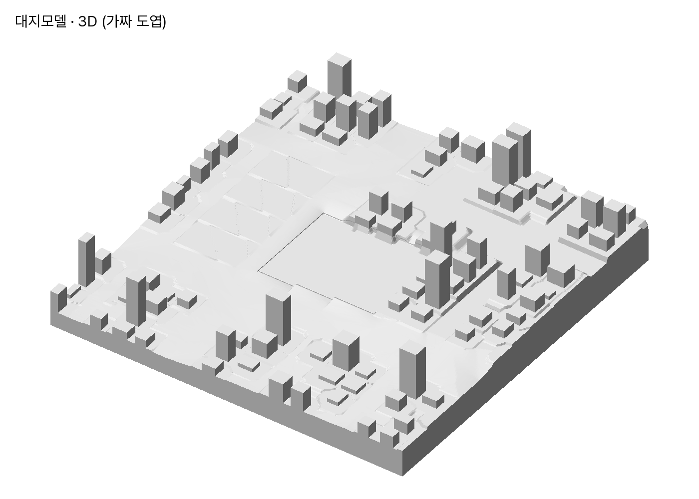

# 콘타 모델 만들기

국토정보플랫폼 **수치지도(수치지형도 2.0, SHP zip)** 를 넣으면 건축 **콘타 모형**을 자동으로 만들어 주는 프로그램입니다.
**윈도우 다운로드판**으로 씁니다. 파이썬 등 따로 설치할 것 없이 zip 을 풀고 `콘타모델 실행.bat` 을 더블클릭하면 브라우저에 화면이 열립니다.

**내려받기:** 이 저장소의 **Releases** 최신 판(`contour_model_windows_v버전_날짜.zip`)



## 무엇을 만들어 주나

| 결과 | 쓰임 |
|---|---|
| 레이저 재단 판 (DXF, 판마다 한 장) | 5m = 5mm 계단 판. 건물 자리에는 구멍, 나무 자리 표시 |
| Rhino 모델 (`model.3dm`) | 렌더용. 지형, 건물(층수 기반 매스 + 창문·지붕 디테일), 길·차선·횡단보도, 가로수·숲, 가로등, 고가·교량을 레이어로 나눔 |
| 3D 프린트 (`model.stl`) | mm 단위 닫힌 솔리드 한 덩어리 |
| 3D 보기 (`model.glb`), 스케치업 (`.dae`) | 웹·스케치업에서 열기 |
| 평면 확인 그림, 대지 분석(경사·절성토) | 확인용 |

**계단식 대지**(기본으로 켜짐): 비탈에 들어선 건물마다 평평한 터를 만들고, 옹벽·석축·담장·길로 둘러싸인 마당까지 같은 높이로 채웁니다. 터 사이와 터 둘레는 옹벽처럼 급하게 끊기고(옹벽 선 가까이는 거의 수직, 그 밖은 1:1 비탈), 높이 차 1m 안의 이웃 터는 한 단으로 합칩니다. 논은 한 필씩 평평하게, 비탈의 큰 논은 1.5m마다 다랑이로 나눕니다. 수치지도의 건물·옹벽(높이)·석축·절토·성토 선·담장·논·길 면을 씁니다(브이월드 3D 지형은 약관상 쓰지 않음). 끄려면 화면의 '계단식 대지' 스위치 또는 `--no-pads`.

대지 경계 파일(DXF·SHP·GeoJSON)을 함께 넣으면 대지를 가운데로 잡고 경계를 새기며, 도면에 계획 레벨(EL+178.00 같은 글자나 높이 있는 선)이 있으면 대지 안 지형을 그 레벨로 다시 만듭니다.

## 쓰는 법

1. [국토정보플랫폼](https://map.ngii.go.kr)에서 원하는 곳의 **수치지도 2.0(SHP)** 도엽 zip 을 받습니다. 대지가 두 도엽에 걸치면 둘 다 받습니다.
2. Releases 에서 윈도우판 zip 을 받아 **모두 압축 풀기** → `콘타모델_윈도우` 폴더의 **콘타모델 실행.bat** 더블클릭 (파란 'PC 보호' 창이 뜨면 추가 정보 → 실행).
3. 열린 화면에 도엽 zip 을 끌어다 놓습니다. 대지 도면 DXF 가 있으면 같이 놓습니다.
4. 지도에서 범위를 고르고(대지를 넣으면 자동) 용도(레이저 · 렌더 · 빠르게)를 고른 뒤 **만들기**. 결과는 `C:\Users\내이름\콘타모델` 에 저장됩니다.

64비트 Windows 10·11.

화면 기능 전체 설명은 [docs/사용법_전체.md](docs/사용법_전체.md) 에 있습니다.

## 넣지 않는 자료 (꼭 지킬 것)

- **정밀도로지도**(재배포 금지), **실제 수치지도 도엽**, **개인 사업지 도면** 은 저장소에 올리지 않습니다. 사용자가 자기 파일을 화면에서 올리는 방식입니다. `.gitignore` 가 zip·dxf·dwg·3dm 등을 막아 둡니다.
- **API 인증키**(브이월드, 공공데이터포털 등)는 코드·저장소에 쓰지 않습니다. 윈도우판에서는 각자 화면의 설정 칸에 자기 키를 넣습니다.

## 개발 방식

- **개선은 브랜치에서 하고 PR 로 올립니다.** PR 에는 바뀐 점, 시험 결과, 확인 그림을 담습니다.
- **자동 시험** ([`.github/workflows/ci.yml`](.github/workflows/ci.yml)): 커밋을 올릴 때마다 Windows 와 Linux 에서
  1. 설치 (`requirements-server.txt`, 버전 고정)
  2. 가짜 도엽(`tests/make_fake_sheet.py`, 지어낸 지형·건물·길)으로 300m 모델 두 벌 만들기: 기본 모델, 대지 경계 + 레벨 도면 + 대지 비우기 모델
  3. 결과 확인: Rhino 파일 열림, 레이저 판 DXF 열림, STL 닫힌 솔리드·실제 축척, GLB 열림
  4. 화면(웹 서버 모드 포함)이 열리는지
  5. 확인 그림(3D · 평면 · 레이저 판)을 Actions 실행 화면의 **Artifacts** 로 남김 (Linux 는 결과 모델 파일도)
- **윈도우판 배포** ([`.github/workflows/windows.yml`](.github/workflows/windows.yml)): Windows 에서 zip 을 묶고, 새 폴더에 풀어 `.bat` 으로 가짜 도엽 모델을 두 번 만들어 봅니다. `main` 이고 그 버전(`contour_ai/__init__.py`)의 릴리스가 없으면 **Releases** 에 올립니다. 새 판을 내려면 버전을 올리세요.

## 폴더

```
contour_ai/          프로그램 본체 (같은 코드로 공개 서버와 PC 화면을 모두 돌림)
  web/               화면 (HTML · JS)
  data/              내장 가로수 대장 (공개 자료)
tests/               자동 시험 (가짜 도엽 생성기, 모델·서버 시험, 확인 그림)
docs/                전체 사용법, 예전 개발용 시험 스크립트, README 그림
windows/             윈도우판 묶기 스크립트·실행 .bat·안내문
```

## 직접 돌려 보기 (개발자용)

```
pip install -r requirements-server.txt pytest
python -m pytest tests -v              # 시험
python tests/render_previews.py        # 시험결과/확인그림/
python -m contour_ai                   # PC 화면
CONTOUR_SERVER=1 python -m contour_ai serve   # 공개 서버 모드
```
